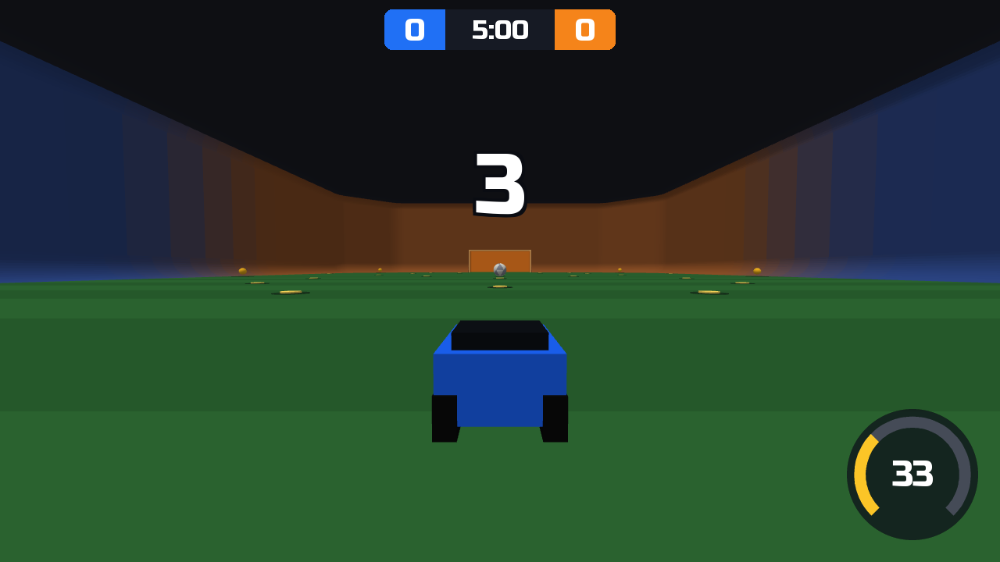
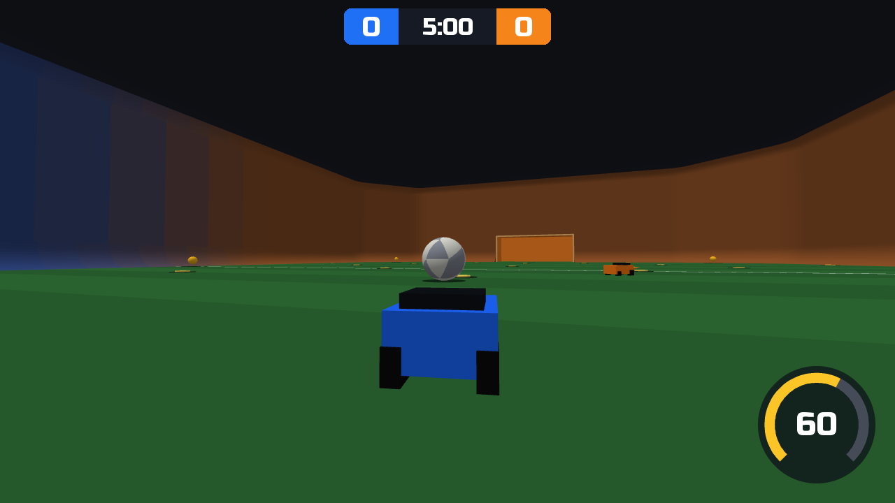
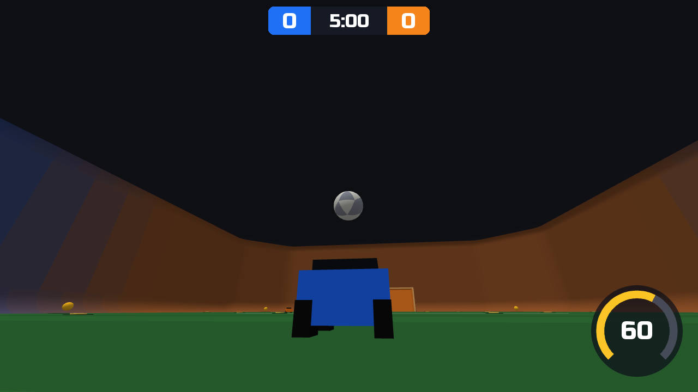
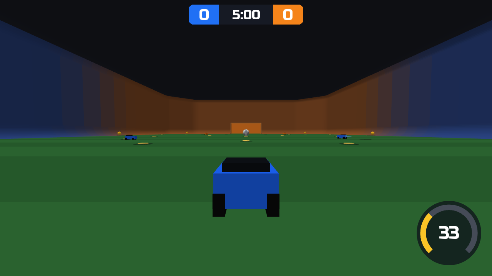

# rocketsim-gym

Rocket League-style soccar to play against bots on your own computer, 1v1, 2v2 or 3v3, and the same game as a [Gymnasium](https://gymnasium.farama.org) env for AI agents, so that a person and a model play exactly the same game. It runs on [RocketSim](https://github.com/ZealanL/RocketSim), a simulation of Rocket League's physics, on a homemade arena: nothing from Rocket League itself is needed. It is made for [fmri-gym](https://github.com/tomov/fmri-gym), which runs games for people to play in an MRI scanner.






## Get started

Two commands: the first installs [uv](https://docs.astral.sh/uv/), which fetches the game and the Python it runs on, apart from everything else on your computer; the second starts a match.

**1. Install uv**, once. On macOS or Linux, in a terminal:

```bash
curl -LsSf https://astral.sh/uv/install.sh | sh
```

On Windows, in PowerShell:

```powershell
powershell -ExecutionPolicy ByPass -c "irm https://astral.sh/uv/install.ps1 | iex"
```

Then close the terminal and open a new one, so that it finds `uv`.

**2. Play**, whenever you like, the same command everywhere:

```bash
uvx --from https://github.com/hyruuk/rocketsim-gym/archive/main.zip rocketsim-play
```

A window opens on a 5-minute 1v1 match against a bot. The first start downloads what the game needs and takes a minute or so; later ones take seconds. If the window opens behind the terminal, click it. Add `--team-size 2` at the end for 2v2 or `--team-size 3` for 3v3, with bots for your teammates and your opponents, `--seconds 120` for a shorter match, or `--window 1920x1080` for a bigger window. Rocket League players can bring their own camera and controller settings, in the game's units, for example `--field-of-view 110 --distance 270 --height 100 --angle -3 --stiffness 0.45 --transition-speed 1.2 --deadzone 0.05 --steering-sensitivity 1.3 --aerial-sensitivity 1.3`.

It runs on a Mac with Apple silicon (M1 or later, macOS 14 or later), on 64-bit Windows 10 or 11, and on Linux (x86_64 or ARM64), with graphics that support OpenGL 3.3, as any computer from the last ten years does. Intel Macs cannot run it: RocketSim publishes no version for them.

### Controls

The keyboard and mouse follow Rocket League's PC defaults, each key a full press. An Xbox-style controller (Xbox, PlayStation, Switch Pro) works too, plugged in before or during the match: its triggers and stick count as far as they are pushed, as in Rocket League (`--input digital` makes them all or nothing, as a scanner's controller may be).

| Action | Keyboard and mouse | Controller |
|---|---|---|
| Drive / reverse | W / S | right trigger / left trigger |
| Steer | A / D | left stick |
| Tilt the nose down / up, in the air | W / S | left stick |
| Jump (again in the air to flip) | right mouse button | A |
| Boost | left mouse button | B |
| Powerslide, and air roll with the stick | left Shift | X |
| Ball cam on or off | Space | Y |
| Air roll left / right | Q / E | |

The score, the clock and your boost are on screen, as in Rocket League. Esc quits; when the match is over, Enter plays another.

F3 (fn+F3 on most Mac keyboards), or the controller's Back button, shows and hides the stats in the window's corner: the frames shown a second and the slowest, and in a LAN match the input delay, the frames shown twice or skipped, and the state of the room and of the connection. `--stats` shows them from the start.

### Updating

`uvx` keeps the version it downloaded. To play the latest one, run once:

```bash
uvx --refresh --from https://github.com/hyruuk/rocketsim-gym/archive/main.zip rocketsim-play
```

### If it does not start

- **RocketSim cannot be installed** (an error naming `rocketsim`): the computer is not one RocketSim supports; see above.
- **"no OpenGL 3.3 context opens to draw frames"**: update the graphics drivers. On Linux, install EGL too; on Debian or Ubuntu: `sudo apt install libegl1 libgl1-mesa-dri`.
- **The controller does nothing**: check that other games see it, then start the game again with it plugged in.

## Play with others on a local network

Several people, each at their own computer, can play one match together: any of 1v1 to 3v3, as teammates or opponents, with bots in the seats nobody takes. One computer runs a match server, which plays the match; every player's window sends its controls to it and shows the match from the player's own car. The computers need not be alike (a Mac and a Linux PC play together), but they need the same version of this package. Only the server needs RocketSim, so a player's computer can be one RocketSim does not support, such as an Intel Mac.

### A 1v1 on two computers

One computer hosts the match and plays blue; the other joins it and plays orange. The commands are the same on macOS, Linux and Windows. A computer that has played an older version adds `--refresh` after `uvx` the first time, to fetch this one.

**On the computer that hosts**

1. If it has a firewall, let the game through:
   - Ubuntu or Debian: `sudo ufw allow 47800:47801/udp && sudo ufw allow 47800/tcp` (with `ufw` inactive, as `sudo ufw status` says, there is nothing to do)
   - Fedora: `sudo firewall-cmd --add-port=47800/tcp --add-port=47800-47801/udp`
   - macOS 15 or later: in System Settings › Privacy & Security › Local Network, allow the terminal app you use
   - Windows: allow it when the firewall asks, on a network set to Private
2. Start the server in a terminal, and leave it running:

   ```bash
   uvx --from https://github.com/hyruuk/rocketsim-gym/archive/main.zip rocketsim-server
   ```

   It prints this computer's address, in a line such as `players join with: rocketsim-play --join 192.168.1.20:47800`. On a Mac, put `caffeinate -i ` in front of the command, so that the Mac does not doze.
3. Join as blue, in a second terminal:

   ```bash
   uvx --from https://github.com/hyruuk/rocketsim-gym/archive/main.zip rocketsim-play --join 127.0.0.1:47800 --seats blue1,orange1 --seat blue1
   ```

   A window opens, waiting for orange.

**On the computer that joins**, with the address the server printed in place of `HOST_ADDRESS`:

```bash
uvx --from https://github.com/hyruuk/rocketsim-gym/archive/main.zip rocketsim-play --join HOST_ADDRESS:47800 --seats blue1,orange1 --seat orange1
```

The first run downloads the game, in a minute or so. As soon as both players are in, the countdown starts on both screens. After a match, Enter in both windows plays another.

### More players

The first player to join sets the match: `--team-size` and `--seconds` as on a single computer, `--seats` the cars people drive (bots drive the others), and `--seat` their own. For a 2v2 with both players on blue against two bots:

```bash
uvx --from https://github.com/hyruuk/rocketsim-gym/archive/main.zip rocketsim-play --join HOST_ADDRESS:47800 --team-size 2 --seats blue1,blue2 --seat blue1
```

The others join that match with `--join HOST_ADDRESS:47800` alone, taking the first free seat, or the one `--seat` names. Without an address, `--join` looks for the server on the network by itself, where the network lets it. Each player sees a waiting screen until everyone is in.

### The server's commands

While a match is on, the server's terminal takes these:

- `status`: who is in which seat, and how many frames each player's controls take to arrive.
- `pause`, and `resume`: a player whose computer drops out (its window closes, or it stops answering for 2 s) pauses the match for everyone. That player starts the same join command again, and `resume` goes on once everyone is back.
- `bot SEAT`: a bot drives that seat to the end of the match.
- `end`: the match ends now.
- `quit`: the server stops.

Its console takes the keyboard, so for real sessions it belongs on a computer nobody plays on. Each match's log goes to `matches/`, with every player's controls, step by step; `rocketsim_gym.lan.match_log.replay_match(path)` plays it again and checks that it gives the same match, which it does on the server's computer.

### If it does not connect

- **"nothing answers" or "no answer within 3 s"**: the server is not running at that address, or the network keeps the computers apart, as campus and guest Wi-Fi often do; `ping HOST_ADDRESS` from the joining computer tells which. A home router, a phone hotspot or a cable between the two computers then does.
- **The host's match pauses at once, and the other player stays on "Joining the match"**: the join got through, but the game's own traffic (UDP) does not reach the host. Its firewall drops it (see step 1 above), or, on a computer an institution manages, security software (Cisco Secure Client, for one) does, whatever you allow. Then let the other computer host.
- **"no OpenGL 3.3 context"**: see "If it does not start" above.

Wired is best; Wi-Fi works, with occasional hiccups. A player's controls take a frame or two longer to show than on their own computer, and the server applies every one of them in order, so a quick tap is never lost.

## Status

Early. What works today: a whole 1v1, 2v2 or 3v3 match on the homemade arena with scripted bots that take turns at the ball, with Rocket League's match rules, seen from Rocket League's car cam and ball cam with its on-screen display, played with digital or analog controls and the player's own camera and controller settings; matches with other players on a local network; the play window; and the Gymnasium env behind them. The arena and the cars are homemade and low-poly. Next, in this order:

1. The real arena, from collision meshes dumped from a Rocket League install.

## Use it from Python

```bash
pip install https://github.com/hyruuk/rocketsim-gym/archive/main.zip
```

```python
import gymnasium
import rocketsim_gym  # registers RocketSimSoccar-v0

env = gymnasium.make("RocketSimSoccar-v0", match_seconds=60, team_size=2)
observation, info = env.reset(seed=0)
terminated = False
while not terminated:
    observation, reward, terminated, truncated, info = env.step(env.action_space.sample())
print(info)  # {'phase': 'ended', 'blue_score': ..., 'orange_score': ...}
```

## The env

A match is 1v1, 2v2 or 3v3. The agent drives blue's first car, and scripted bots drive every other one. A team's cars take turns at the ball, as Rocket League players rotate: the car nearest the ball goes for it, a car past the ball counting as farther, and the others wait in line behind it, between the ball and their own goal. The agent's car counts as one of its team's, so its teammates leave the ball to it while it is nearest; in 1v1 the bot is alone on its team and always goes. The car whose turn it is drives at the ball, aiming a little behind it so that its touch sends the ball toward the goal it attacks, boosts while it faces the ball and powerslides through sharp turns; a waiting car drives to its spot and stops there. A bot that pushes on without moving, against a goal post say, backs off, and one stuck on its side or its roof jumps and rolls back onto its wheels; it jumps for nothing else.

The match follows Rocket League's rules: a 3 s countdown holds everything still before each kickoff; the clock starts at the kickoff's first touch; a goal pauses play for 3 s, the ball gone and the cars free to drive, before the next kickoff; when the clock reaches zero, play goes on until the ball touches the ground; a tie goes to overtime, which the next goal wins; a demolished car comes back 3 s later.

**Arguments**: `match_seconds`, the regulation time (300); `team_size`, the cars a team: 1, 2 or 3 (1); `ticks_per_step`, physics ticks per step at 120 ticks a second (2, so 60 steps a second); `render_mode`, `"rgb_array"` to draw frames; `render_width` and `render_height`, a frame's size (1024x576); `camera`, the player's camera settings, by the names of Rocket League's settings menu and in its units: `field_of_view` (110), `distance` (270), `height` (100), `angle` (-3), `stiffness` (1) and `transition_speed` (1), each within the menu's range; `input_mode`, `"digital"` (the default) or `"analog"`; `controller`, the player's controller settings for the stick: `deadzone` (0), `steering_sensitivity` (1) and `aerial_sensitivity` (1).

**Action**: a game controller, with Rocket League's default controls. In `"digital"` input mode, twelve buttons, each held or not (`MultiBinary(12)`), sticks and triggers at full deflection, as keys and some scanner controllers give them. In `"analog"` input mode, ten values (`Box(10)`): the triggers and the stick as far as they are pushed, through the player's `controller` settings, and six buttons, each pressed above 0.5. Digital is analog pushed all the way: the same buttons play the same match in either mode. The car obeys its controls except in a countdown and while it is demolished.

Digital:

| Index | Button | Car control |
|---|---|---|
| 0 | throttle | throttle +1 |
| 1 | reverse | throttle -1 (with throttle: none) |
| 2 | stick_left | steer -1, and in the air yaw -1 (roll -1 with powerslide) |
| 3 | stick_right | steer +1, and in the air yaw +1 (roll +1 with powerslide) |
| 4 | stick_up | pitch -1: nose down |
| 5 | stick_down | pitch +1: nose up |
| 6 | jump | jump |
| 7 | boost | boost |
| 8 | powerslide | handbrake on the ground; in the air, the stick rolls |
| 9 | ball_cam | no control: switches the camera between car and ball when pressed |
| 10 | air_roll_left | roll -1 |
| 11 | air_roll_right | roll +1 |

Analog:

| Index | Input | Range | Car control |
|---|---|---|---|
| 0 | throttle | 0 to 1 | throttle, less the reverse trigger |
| 1 | reverse | 0 to 1 | throttle backward |
| 2 | stick_x | -1 to 1 | steer, and in the air yaw (roll with powerslide) |
| 3 | stick_y | -1 to 1 | pitch: -1 pushed up (nose down), +1 pulled down |
| 4 | jump | 0 to 1 | jump |
| 5 | boost | 0 to 1 | boost |
| 6 | powerslide | 0 to 1 | handbrake; in the air, the stick rolls |
| 7 | ball_cam | 0 to 1 | no control: switches the camera |
| 8 | air_roll_left | 0 to 1 | roll -1 |
| 9 | air_roll_right | 0 to 1 | roll +1 |

**Observation**: in Rocket League's units (uu, uu/s, rad/s), 87 values in 1v1, 127 in 2v2 and 167 in 3v3 (`rocketsim_gym.env.observation_size`), in this order:

| Values | What |
|---|---|
| 9 | the ball: position, velocity, angular velocity |
| 20 for each car | blue's cars, then orange's, each team's by number, so the agent's comes first: position, velocity, angular velocity, forward direction, up direction, boost (0-100), on the ground, can jump or flip, supersonic, demolished |
| 34 | each boost pad, in RocketSim's order: 1 while it can be picked up |
| 4 | seconds left in regulation, blue's goals, orange's goals, 1 in overtime |

**Reward**: +1 for each blue goal, -1 for each orange goal. The episode terminates when the match ends; `info` holds the phase and the score.

**Frames**: with `render_mode="rgb_array"`, `render()` returns the frame of the latest step, as Rocket League's camera behind the agent's car sees it, car cam or ball cam (the `ball_cam` button switches), with Rocket League's on-screen display over it: the scoreboard and clock, the boost meter, and the banners (the kickoff countdown, GO!, GOAL!, OVERTIME, the winner, DEMOLISHED). By default the camera hangs 270 uu behind the car and 100 above, looking 3 degrees down, with a 110 degree field of view, as many players set theirs, held rigidly behind the car; on a wall, the wall becomes its floor. The ball casts a shadow straight down, its panels show its spin, and a boosting car trails a flame. The camera moves in `step`, and a frame is drawn once however often it is asked for, so drawing changes nothing in the match. Drawing needs OpenGL 3.3, without a window: EGL on Linux, so no display is needed there.

**Logging**: `env.unwrapped.sample()` returns the same fields after every step (`env.unwrapped.sample_fields`): the phase, clock and score, the ball, each car's state, what happened during the step (a goal, each car's touch and demolition) and the controls each car obeyed, each car's fields after its name, from `blue1`, the agent's, to `orange3`. `env.unwrapped.provenance()` names what a match depends on besides its seed and actions: the package versions, the collision meshes' SHA-256s, the cars a team, the tick rates and the OpenGL renderer.

**Replay**: the kickoff and respawn spots come from the env's random generator, seeded by `reset`, and RocketSim's own random kickoffs and respawns are never used. So the same seed and the same actions give the same match, step for step, in any process on the same machine. Floating-point physics is not promised to match across machines.

## The arena

RocketSim simulates Rocket League's physics but needs the arena's collision meshes, which come from a Rocket League install. This package ships a homemade arena instead, built from Rocket League's published field dimensions, so it runs anywhere and holds nothing from the game. Its curves, corners and goal depths are estimates, to be calibrated against the real meshes. Those can be dumped on a Windows PC that has the game ([DUMPING_COLLISION_MESHES.md](DUMPING_COLLISION_MESHES.md)) and checked with this package's tool; they stay with the game's owner and are never redistributed.

## What is here

- `rocketsim_gym.env`: `SoccarEnv`, registered as `RocketSimSoccar-v0`: a match simulation, and a view behind the agent's car.
- `rocketsim_gym.simulation`: `MatchSimulation`, one match on RocketSim played a step at a time: the cars its clients drive obey the controls they give, and bots drive the others.
- `rocketsim_gym.snapshot`: `Snapshot`, a match at the end of a step, everything a view, the observation and `sample()` read, and its bytes. It keeps RocketSim's float32 values as they are, so an unpacked snapshot gives the same observation, sample and frame as the one it was packed from.
- `rocketsim_gym.view`: `SoccarView`, one player's view of a match: the camera behind their car, on car cam or ball cam, and the frame with the on-screen display, drawn from snapshots.
- `rocketsim_gym.lan`: matches over a local network. `protocol` is what servers and clients say to each other; `room` is a server's room and the rules it follows (who may join, when a match starts, pauses and goes on, each player's controls queued in order); `server` is `rocketsim-server`; `connection` finds servers and joins one; `client` is a player's side, with the buffer that shows the server's frames in order; `match_log` is a match's log, and replaying it.
- `rocketsim_gym.boost_pads`: the field's boost pads, written out so that a computer without RocketSim draws them.
- `rocketsim_gym.pacing`: keeping time for the play window's and the server's loops.
- `rocketsim_gym.match`: the match rules, a state machine told what happened each tick and answering what the arena must do.
- `rocketsim_gym.controls`: the inputs, digital or analog, and the car controls they make through a player's controller settings.
- `rocketsim_gym.bot`: the bots: whose turn it is at the ball, where the others wait, the ball-chaser, and the watch that frees a stuck car.
- `rocketsim_gym.camera`: car cam and ball cam, the rig behind the car that follows it.
- `rocketsim_gym.renderer`: draws the frames offscreen with OpenGL (moderngl): the arena the physics uses, the ball, the cars and the boost pads.
- `rocketsim_gym.hud`: the on-screen display, what it shows at each moment of a match and how it is painted.
- `rocketsim-play` (`python -m rocketsim_gym.play`): the play window.
- `rocketsim_gym.engine`: `load_rocketsim(folder, manifest)` loads RocketSim with one folder of meshes per process, after checking every file against its manifest; `SoccarArena` is a soccar arena of one car a team or more, placed only by setting state and stepped a tick at a time, each tick's goal, touches and demolitions reported.
- `rocketsim_gym.arena_geometry`: the homemade arena as one triangle mesh (`build_homemade_soccar_arena`), and RocketSim's collision-mesh files: read, write, their SHA-256 manifest, and RocketSim's own mesh hash. RocketSim adds the floor, a ceiling plane and the side walls itself; the mesh is everything else (the curves into the walls and the ceiling, corner and back walls, the ceiling, the goals). `python -m rocketsim_gym.arena_geometry FOLDER` writes it, as `rocketsim_gym/collision_meshes/homemade/` holds it.
- `python -m rocketsim_gym.check_collision_meshes FOLDER`: describes each mesh file, loads the folder, measures how the arena plays (rest heights, a shot at each goal, a drive up a wall), and writes the folder's manifest and a report.
- [DUMPING_COLLISION_MESHES.md](DUMPING_COLLISION_MESHES.md): the brief for dumping Rocket League's own meshes on a Windows PC with the game, for a person or an agent such as Claude Code.

## Traps

- RocketSim reads its meshes once per process. A file it cannot parse leaves it unusable for the rest of the process, and an arena made before it is loaded reads a `collision_meshes` folder from the working directory; `load_rocketsim` checks first and loads explicitly.
- RocketSim's grid broadphase spends about a second building, first stepping and deleting each arena over a mesh that spans the whole field; `new_soccar_arena` uses Bullet's own broadphase, which costs nothing there.
- A ball whose velocity is exactly zero does not move until something touches it: the kickoff ball waits for its first touch, and the ball out of play after a goal waits behind a corner wall.
- Kickoffs and demolition respawns in RocketSim (`reset_kickoff`, `Car.respawn`, the automatic respawn) draw from a clock-seeded random generator. `SoccarArena` sets cars and the ball by state instead and turns the automatic respawn off.

## Development

```bash
git clone https://github.com/hyruuk/rocketsim-gym
cd rocketsim-gym
uv sync
uv run rocketsim-play
uv run pytest
uv run ruff check .
```

The tests check the arena's mesh and how RocketSim plays it (rest heights, drives up every kind of wall onto the ceiling, goals, the goal frame, nothing leaving the arena); the match rules, event by event; each button's controls and which way RocketSim turns on them, the analog inputs, the dead zone and the sensitivities, and digital as analog pushed all the way; the bots: the chaser, whose turn it is at the ball, where the others wait, and stuck cars coming free; the arena's kickoffs of one to three cars a team, demolitions and respawns; the env, in each team size: Gymnasium's own checker, whole matches, the logged fields, and a match replayed identically in a second process; the camera and its settings; the frames: where the ball and the cars land on the screen, the shadow, the flames and the ball's spin, that drawing changes nothing, and the same pixels in a second process; the on-screen display, at each moment of a match; and the play window's inputs and options. CI runs them on Linux, macOS and Windows; the frames' tests skip where no OpenGL 3.3 context opens.

## License

MIT, in [LICENSE](LICENSE). RocketSim, by ZealanL, is MIT too; its Python bindings are by mtheall. The on-screen text is set in Russo One, by Jovanny Lemonad, under the SIL Open Font License ([rocketsim_gym/fonts/OFL.txt](rocketsim_gym/fonts/OFL.txt)).

Rocket League is a trademark of Psyonix. This project is not affiliated with or endorsed by Psyonix or Epic Games.
